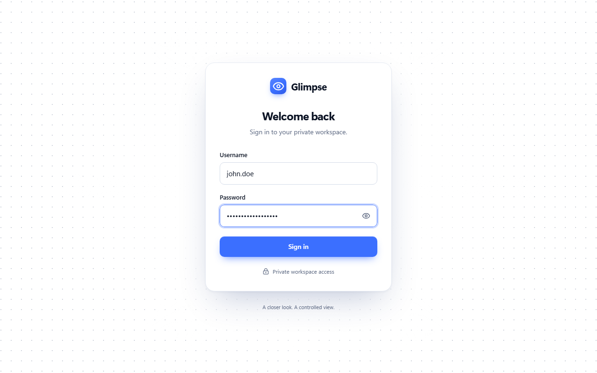
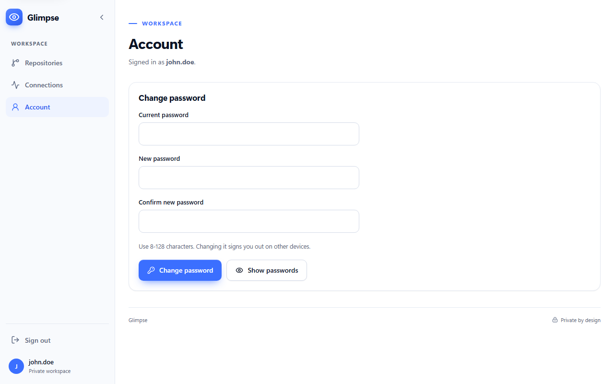

# 1. Signing in and your account

Glimpse has two kinds of users. **Members** sign in to their private workspace, connect GitHub or GitLab and share
repositories. **Visitors** only open access links that a member sent them and never sign in; chapter 8 covers what they
see. Accounts are created by an administrator, so there is no sign-up page.

## Signing in

Open the address of your Glimpse installation and sign in with the username and password your administrator gave you.
The eye button in the password field shows what you typed.

After signing in, Glimpse opens your repositories. If you followed a link to a page inside the workspace, it takes you
back to that page instead.

A session lasts eight hours. When it ends, Glimpse asks you to sign in again and then returns you to where you were.
After several failed attempts in a short time, sign-in is paused for a while with "Too many access attempts. Try again
later."

## The sidebar

The sidebar on the left holds the three pages of the workspace:

- **Repositories** lists the repositories your tokens can read (chapter 3).
- **Connections** holds your GitHub and GitLab tokens and the preview cache (chapter 2).
- **Account** is where you change your password.

At the bottom are your username and **Sign out**. The arrow next to the Glimpse logo collapses the sidebar to icons,
and clicking it again expands it. On narrow screens the sidebar starts collapsed.

## Changing your password

Open **Account**, type your current password and the new one twice, then click **Change password**. **Show passwords**
reveals all three fields.

A password has 8 to 128 characters and must differ from the current one. Changing it signs you out on your other
devices and browsers; the one you are using stays signed in.

If an administrator asked you to set a new password, Glimpse opens this page right after you sign in, with the note
"An administrator asked you to set a new password before you continue." The rest of the workspace opens once the new
password is saved.

## Signing out

Click **Sign out** at the bottom of the sidebar. If you have unsaved file visibility changes (chapter 6), Glimpse first
asks whether to save or discard them.

Signing out ends your workspace session only. Access links you created keep working for their visitors.
