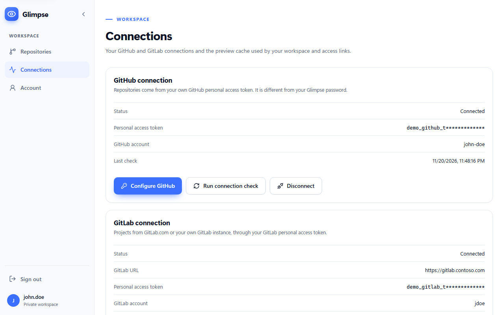
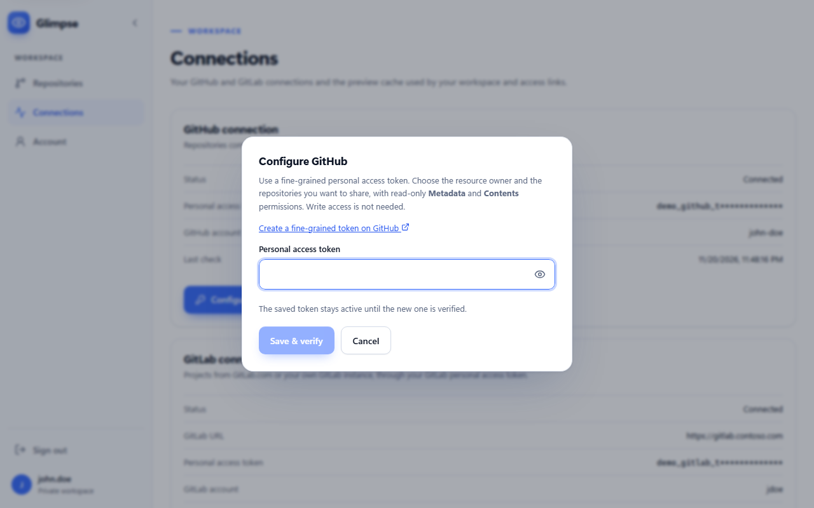
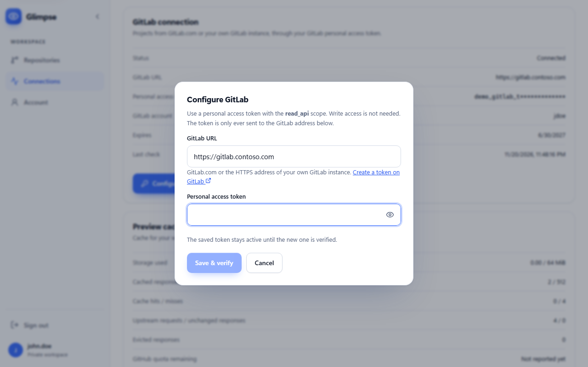
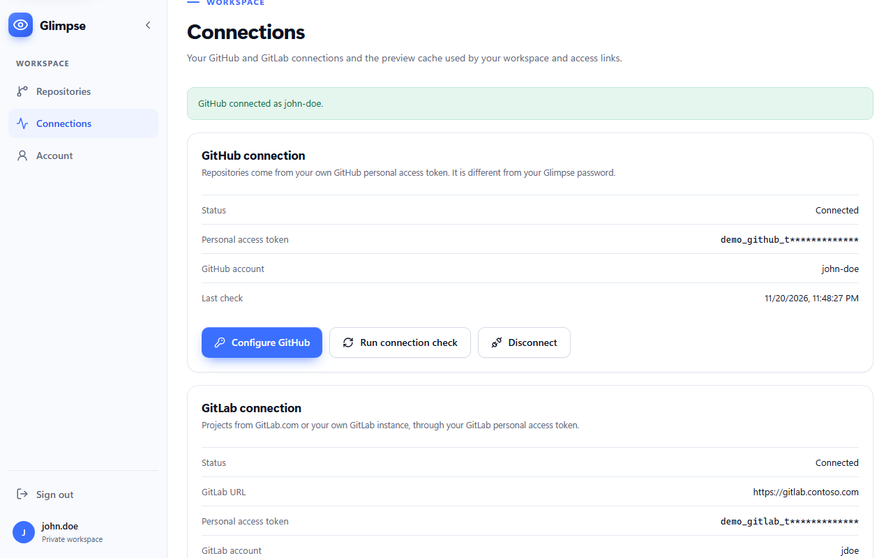
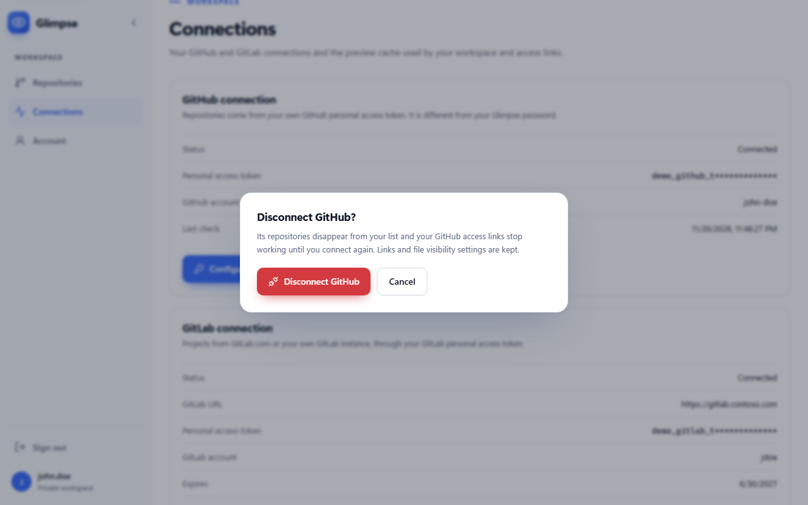
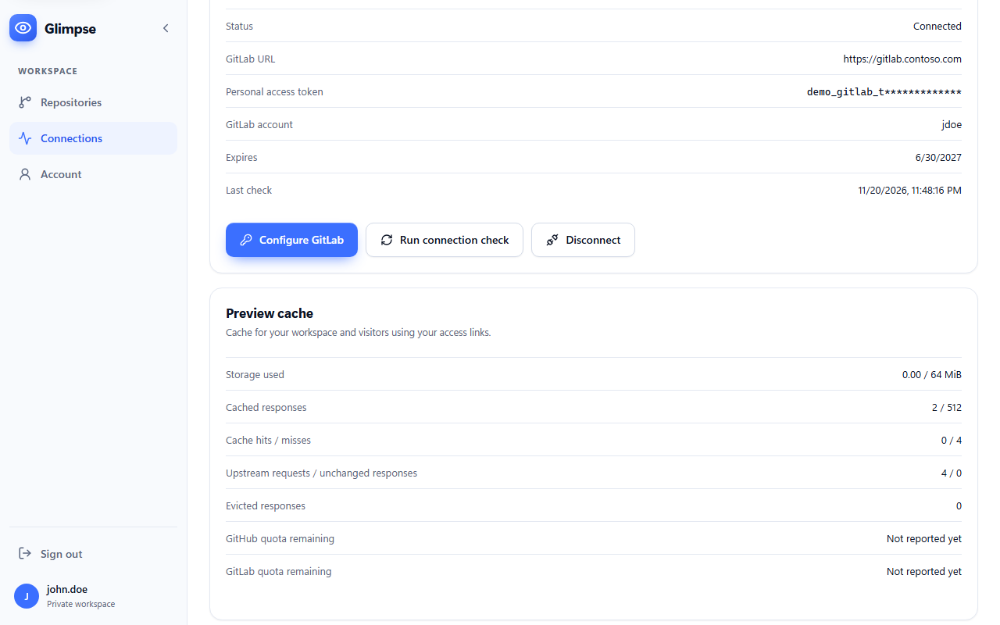

# 2. Connections

Glimpse never stores your GitHub or GitLab password. It reads repositories with a personal access token that you create
on GitHub or GitLab and save in **Connections**. You can connect one platform or both; repositories from both then
appear together in your list.

Each platform has its own card with these details:

- **Status**: Connected, Not verified, Credentials rejected, Access restricted, Temporarily unavailable or Not
  configured.
- **GitLab URL** (GitLab only): the address of the GitLab instance.
- **Personal access token**: only the first half is shown; the rest is masked.
- **GitHub account** or **GitLab account**: the account the token belongs to.
- **Expires** (GitLab only): when the token expires. Within 14 days of that date, the card warns how many days are left.
- **Last check**: when Glimpse last verified the token.

## Connecting GitHub

Click **Configure GitHub**. The link **Create a fine-grained token on GitHub** opens the page where you create the token.

On GitHub, create a fine-grained personal access token:

1. Choose the resource owner (your account or an organization) and the repositories you want to share.
2. Give it read-only **Metadata** and **Contents** permissions. Write access is not needed.
3. Copy the token, paste it into **Personal access token** in Glimpse and click **Save & verify**.

Glimpse checks the token with GitHub before saving it. When it works, the page says "GitHub connected as" followed by
your GitHub account, with a link to your repositories. If GitHub rejects the token, Glimpse explains why, for example
that it was copied incompletely or that an organization has not approved it yet.

## Connecting GitLab

Click **Configure GitLab**. Enter the address of your GitLab instance, or keep `https://gitlab.com` for GitLab.com, and
paste a personal access token with the **read_api** scope.

Once the address is a valid HTTPS URL, the link **Create a token on GitLab** opens your instance's token page with the
name and scope already filled in. The token is only ever sent to the GitLab address you entered.

Glimpse lists the projects in which you have at least the Reporter role.

## Replacing a token

To use a new token, for example when the old one is about to expire, click **Configure** again and save the new one.
The saved token stays active until the new one is verified, so nothing stops working in between.

Connecting a different GitLab instance replaces the old one. Links to projects of the previous instance stop working
until you connect that instance again.

## Checking a connection

**Run connection check** asks GitHub or GitLab whether the saved token still works, and shows the result above the
cards.

When the token was rejected, it has usually expired or been revoked. Configure a new token to continue. When access is
restricted, the token is valid but cannot read the repositories; check its repository access or, for GitLab, its
read_api scope.

## Disconnecting

**Disconnect** removes the saved token. Glimpse asks first:

The platform's repositories disappear from your list, and your access links to them stop working until you connect
again. The links and your file visibility settings are kept, so everything works again after you reconnect.

## The preview cache

To keep pages fast and to save your GitHub and GitLab request quota, Glimpse briefly keeps the files and history it has
read. The **Preview cache** card at the bottom of the page shows how this cache is used, for your own browsing and for
visitors of your links.

- **Storage used** and **Cached responses** show how much of your share of the cache is in use.
- **Cache hits / misses** and **Upstream requests / unchanged responses** show how often the cache answered instead of
  GitHub or GitLab.
- **Evicted responses** counts entries removed to make room for new ones.
- **GitHub quota remaining** and **GitLab quota remaining** show how many requests the platform still allows, and when
  the quota resets.

The card is for information only. **Refresh** in the repository browser always reads the latest state of a branch.
