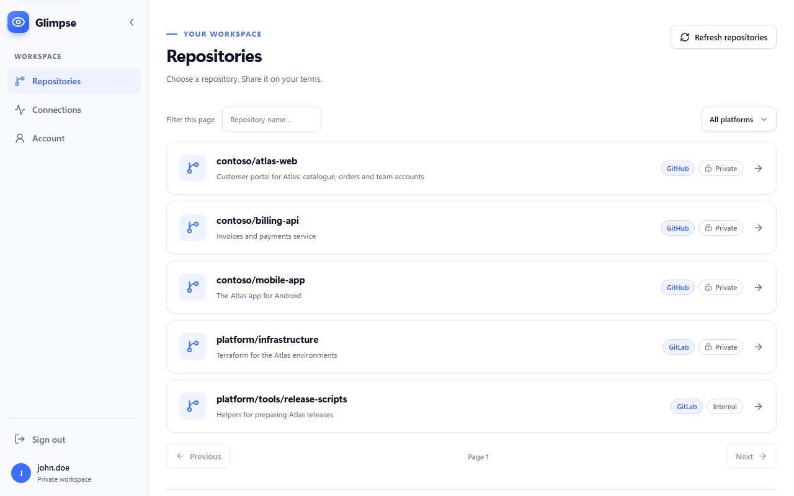
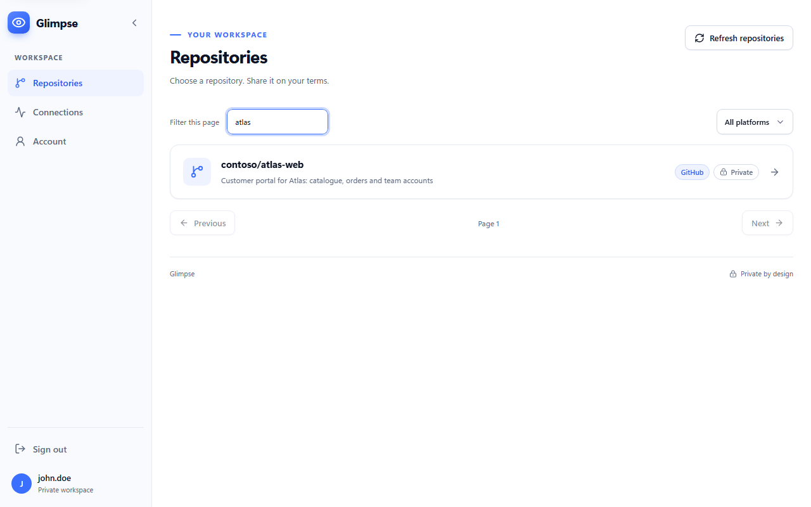
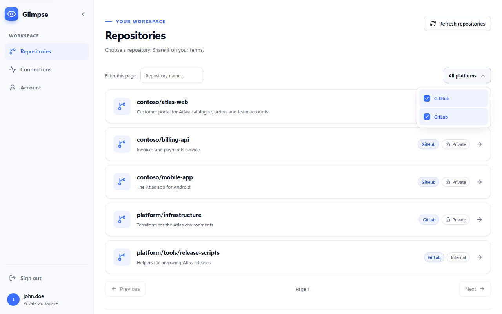

# 3. Repositories

**Repositories** is the first page after signing in. It lists every repository your GitHub token and every project
your GitLab token can read, sorted by name.

Each card shows the repository's full name and description, and badges for its platform and visibility: **Private**,
**Internal** (GitLab only) or **Public**. The platform badge appears only when both platforms are connected. Click a
card to open the repository (chapter 4).

**Refresh repositories** reads the list again, for example after you gave your token access to another repository.

## Filtering

**Filter this page** narrows the cards on the current page to names that contain what you type.

When both GitHub and GitLab are connected, the menu on the right chooses the platforms to list. **All platforms**
shows both; untick one to hide its repositories. At least one platform always stays selected.

With only one platform connected, the menu is replaced by a note such as "Available through your GitHub connection".

## Pages

Each page lists up to 30 repositories from each platform. **Previous** and **Next** move between pages. The filter
applies to the current page only, so a repository on another page does not appear until you go to that page.

## When the list is empty

- **Connect GitHub or GitLab to see your repositories.** No token is saved yet. **Configure GitHub** and **Configure
  GitLab** open the Connections page (chapter 2).
- **No repositories available for this token.** The token works but cannot read any repository. Give it access to the
  repositories you want to share, then update it in Connections.
- **GitHub rejected the saved token** (or GitLab). The token has expired, was revoked or was copied incompletely.
  Configure a new one.
- **GitHub quota is temporarily used up** (or GitLab). The platform limits how many requests a token may make. Wait
  until the time shown and click **Try again**; your token is not affected.

When one platform has a problem and the other works, Glimpse lists the working one and shows the problem in a line
above the list.
