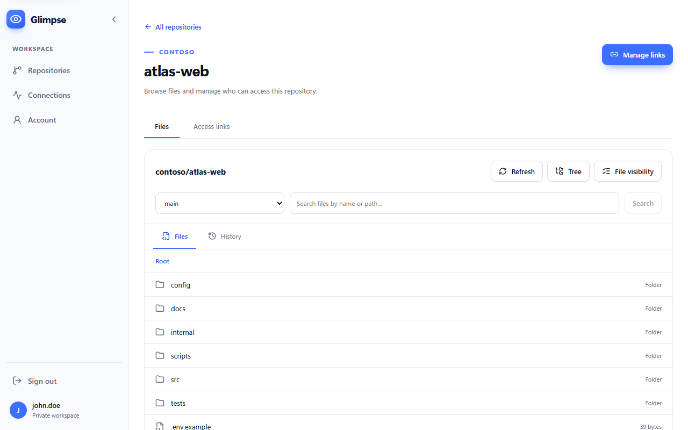
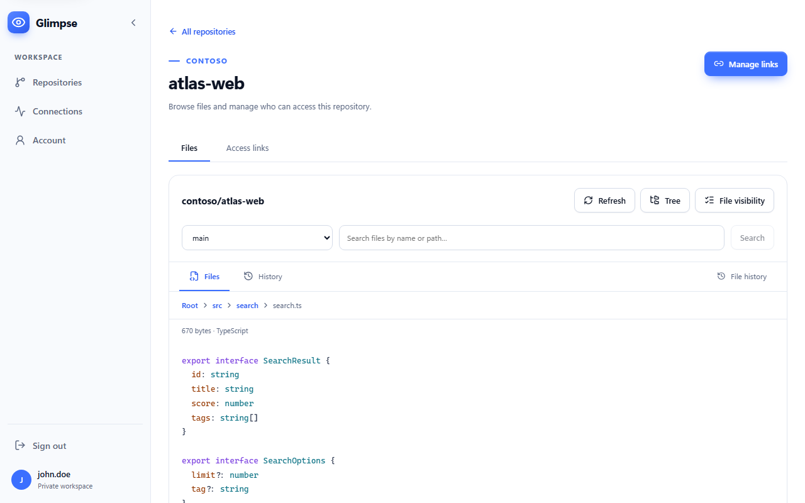
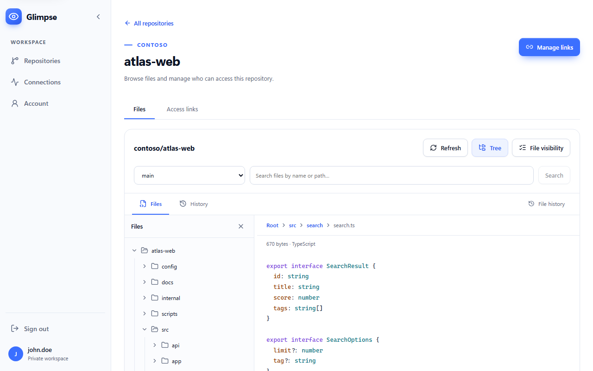
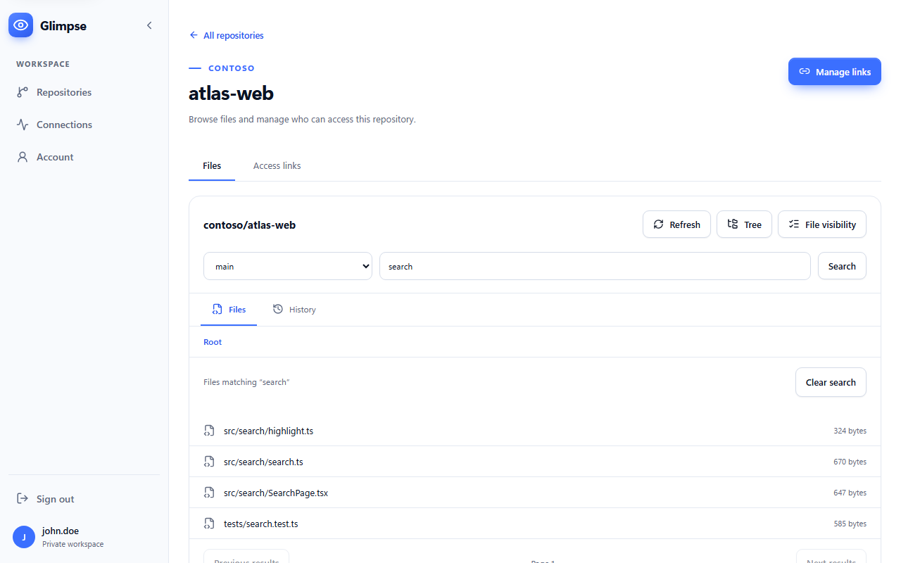
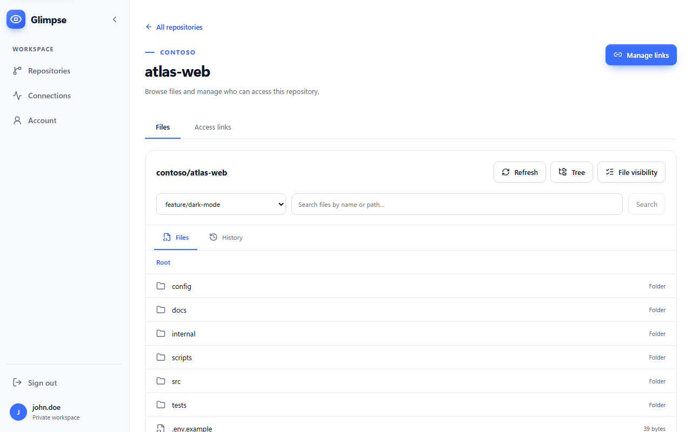

# 4. Browsing files

Click a repository in the list to open its page. The page has two tabs: **Files**, where you browse the code, and
**Access links**, where you share the repository (chapter 7). **Manage links** at the top right opens Access links too,
and **All repositories** goes back to the list.

Glimpse never clones the repository. Folders, files and history are read from GitHub or GitLab when you open them, and
kept briefly in the preview cache.

## The toolbar

- **Refresh** reads the branch again from GitHub or GitLab, without the cache. Use it after pushing new commits.
- **Tree** shows or hides the project tree next to the file list.
- **File visibility** chooses which files visitors of new links can open (chapter 6). Only you see this button.
- The branch menu switches to another branch. Branches are loaded 100 at a time; **Load more branches…** at the end of
  the menu loads the next ones.
- **Search files** finds files by name or path.

Under the toolbar, **Files** shows folders and files and **History** shows the commits of the branch (chapter 5).

## Folders and files

The file list shows the current folder, with folders first. Click a folder to open it, and click **Root** or a folder
name in the path above the list to go back up. Each file shows its size. Submodules are listed but cannot be opened.

Click a file to read it. The line above the code shows its size and the language used for highlighting.

Glimpse highlights the syntax of common languages. Very large files, over 256 KiB or 5,000 lines, are shown as plain
text. Files over 1 MiB or 20,000 lines, and binary files such as images, cannot be previewed; Glimpse says so instead.

When a file is open, **File history** next to the view switch lists the commits that changed it (chapter 5).

## The project tree

**Tree** opens the whole folder structure on the left, so you can move around the repository without going back and
forth in the file list. Click a folder to expand or collapse it, and click a file to open it.

Drag the line between the tree and the file to make the tree wider or narrower. You can also focus that line with
`Tab` and use the arrow keys, `Home` and `End`; double-clicking it restores the default width. On narrow screens the tree
opens as a drawer over the page and closes after you pick a file.

## Searching

Type part of a file name or path into **Search files** and click **Search** or press `Enter`. The results list every
matching file with its path and size; click one to open it.

Results come 50 to a page. **Clear search** returns to the folder you were in.

## Switching branches

Choose another branch in the branch menu to browse it. The file list, search and history then follow that branch.

To see the repository as it was at an earlier commit, open the commit in History and click **Browse this revision**
(chapter 5).
