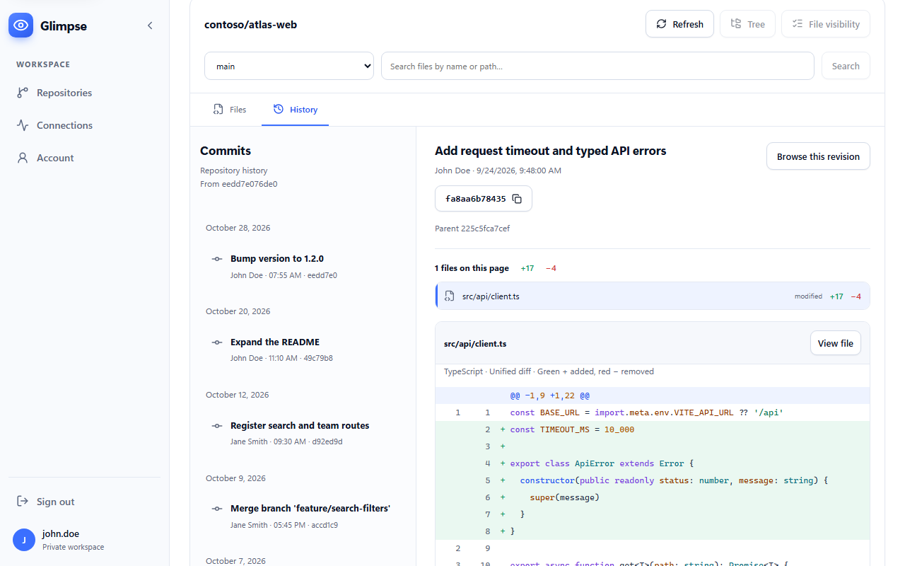
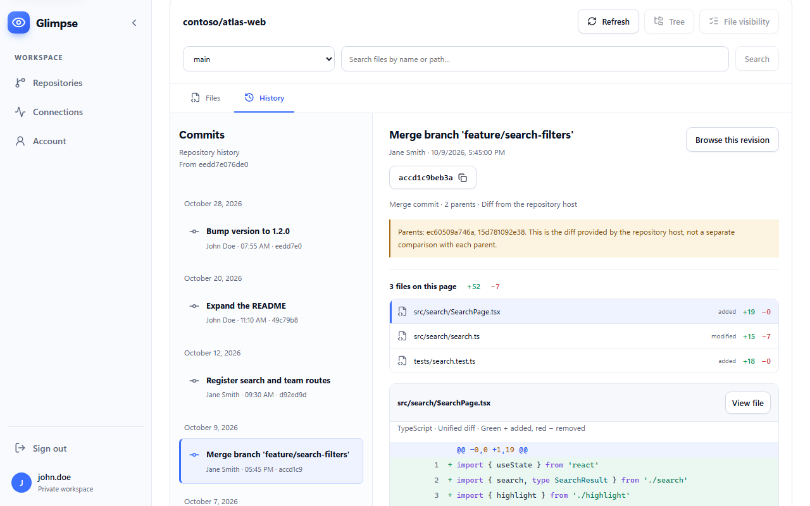
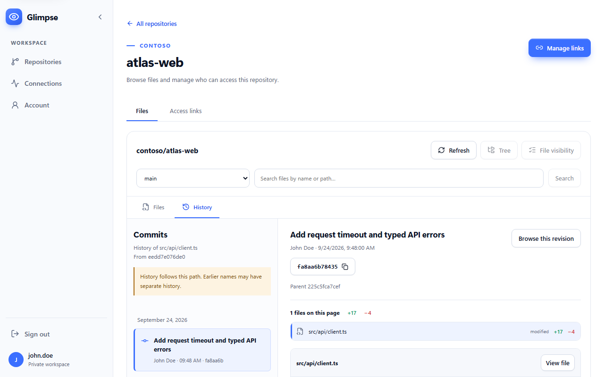
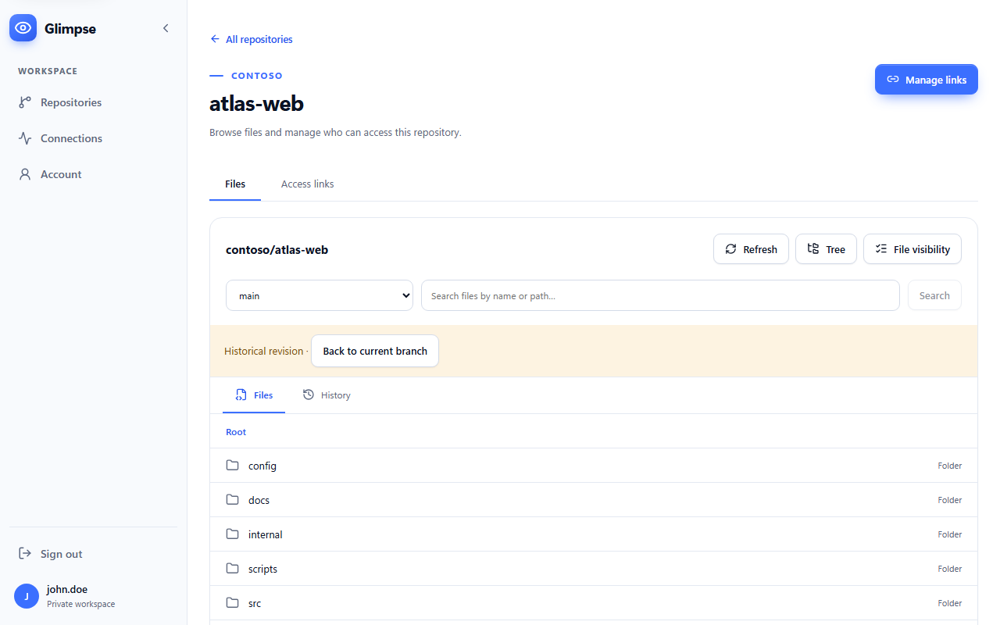

# 5. History

**History**, under the toolbar of the repository browser, shows the commits of the current branch, newest first. Click
a commit on the left to see what it changed on the right.

## The commit list

Commits are grouped by day. Each one shows its title, author, time and short SHA. The heading above the list says where
the history starts: the branch's latest commit, or the revision you are browsing.

The list holds 30 commits per page. **Older** moves to earlier commits and **Newer** back. Drag the line between the
list and the details to resize the list, as with the project tree.

## Commit details

The right side shows the commit's title, author and date, followed by the rest of its message.

- The SHA button copies the full commit SHA. If your browser does not allow copying, Glimpse shows the SHA so you can
  copy it yourself.
- **Browse this revision** opens the repository as it was at this commit (see below).
- The line under the SHA names the parent commit, or says "Initial commit · No parent" for the first commit.

Below that is the list of changed files, with how many lines each one added and removed and the totals for the commit.
Renamed files show their old and new path. Click a file to see its diff.

## Reading a diff

The diff shows the changed part of the file with the old and the new line numbers. Added lines are green with **+**,
removed lines are red with **−**, and the lines around them show where the change is. **View file** opens the file as it
is in that commit; for a deleted file the button is **View before deletion**.

Some changes have no text diff: binary files such as images, renames without changes, and diffs too large for the
preview. Glimpse lists those files and explains why their diff is not shown.

A commit's files come 30 to a page; **Next files** and **Previous files** move between pages.

## Merge commits

For a merge commit, the line under the SHA says "Merge commit" and how many parents it has. The diff is the one GitHub
or GitLab provides for the merge, not a separate comparison with each parent.

## File history

Open a file and click **File history** to list only the commits that changed it.

History follows the file's current path. If the file was renamed, commits from before the rename are listed under its
old name.

## Browsing an older revision

**Browse this revision** opens the files as they were at the selected commit. A notice above the file list says that
you are looking at a historical revision; **Back to current branch** returns to the latest commit.

While you browse a revision, search and folders show that revision's files, and History starts from that commit.
