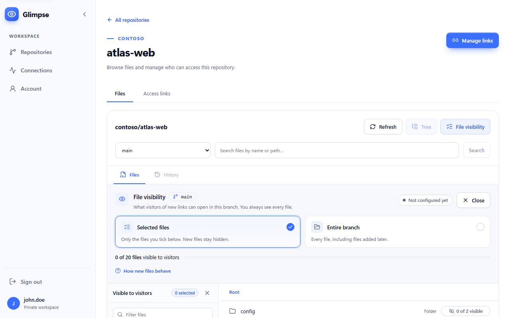
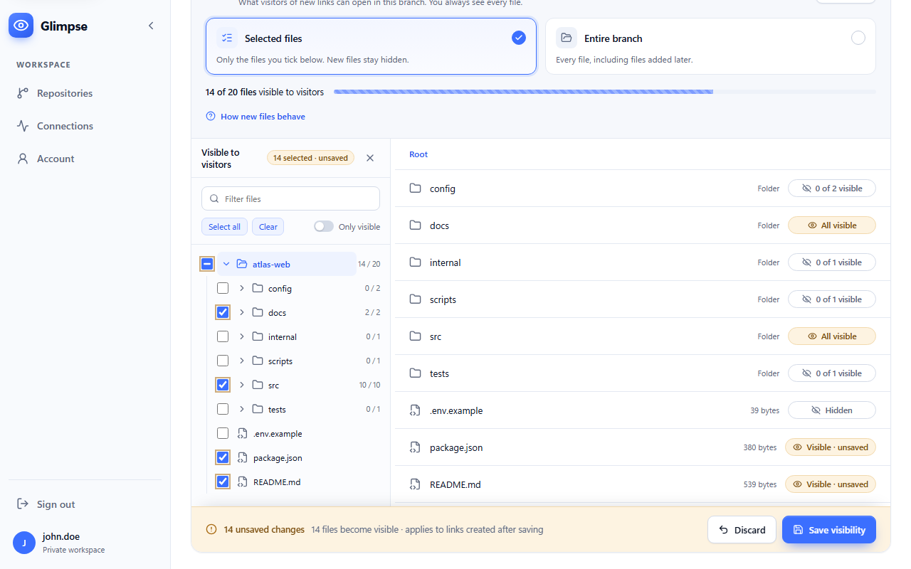
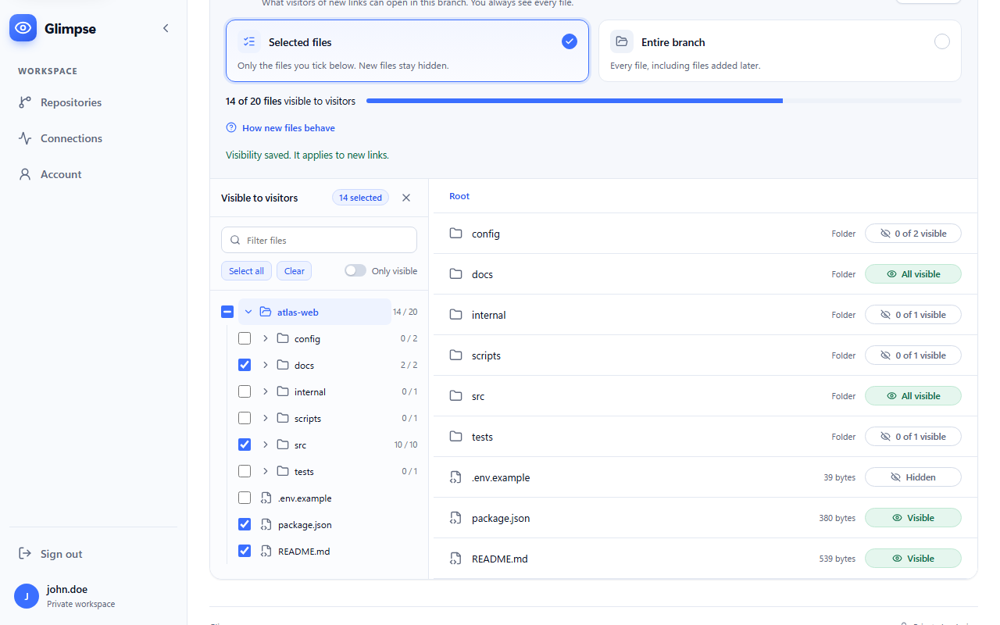

# 6. File visibility

Most repositories hold files that visitors should not see, such as production configuration or internal notes. **File
visibility** chooses, branch by branch, which files a new access link may show. You always see every file yourself.

The rules are saved per branch. A link copies them when you create it (chapter 7), so changing the rules later never
changes a link that already exists.

## Opening file visibility

Open the repository's **Files** tab, choose the branch in the branch menu and click **File visibility** in the toolbar.
The panel opens above the file list, together with the project tree.

The status on the right says whether the branch has rules yet: **Not configured yet**, **Saved**, or how many changes are
not saved.

## Choosing a mode

Under **Visitors can open**, choose one of two modes:

- **Selected files**: visitors open only the files you tick. Files added to the branch later stay hidden until you tick
  them.
- **Entire branch**: visitors open every file, including files added later.

The bar below the modes shows how many of the branch's files are visible to visitors.

## Ticking files

In **Selected files** mode, the tree shows a checkbox next to each folder and file. Ticking a folder ticks everything in
it; a folder with only some files ticked shows a mixed box, and the number next to it shows how many of its files are
ticked. Ticking a box never opens the file.

The tools above the tree help with larger repositories:

- **Filter files** narrows the tree to files whose path contains what you type.
- **Select all** and **Clear** tick or untick every file of the branch.
- **Only visible** shows only the files visitors can open.

While the panel is open, the file list on the right shows a badge for each entry: **Visible** or **Hidden** for files,
and how many files are visible for folders. Changes you have not saved yet are marked "unsaved".

**How new files behave** explains the rules for files that change later:

- New files stay hidden until you tick them, even inside a folder you selected.
- A renamed file gets a new path, so it stays hidden until you tick it again.
- A deleted file that comes back under the same path is visible again.

## Saving

The bar at the bottom of the panel counts your changes and says what they do, for example "14 files become visible".
Click **Save visibility** to save them, or **Discard** to go back to the saved rules.

After saving, Glimpse confirms "Visibility saved. It applies to new links." To share the same files through an existing
link, edit the link and apply the new selection (chapter 7).

You can save up to 100 changes at a time, and a branch can share at most 5,000 selected files. For larger selections,
use **Entire branch**.

If you leave the branch, open History or Access links, or sign out while changes are not saved, Glimpse asks whether to
**Save** or **Discard** them, or to **Stay** where you are. Moving between folders and files of the same branch never
asks.

## Warnings

The panel warns you when the rules need a look:

- **Files on this branch changed since these rules were saved.** New files may have arrived; check them before creating
  links.
- **Selected paths are no longer on this branch.** They stay in the rules and become visible again only if the same path
  returns.
- **The complete file list of this branch was not available.** GitHub or GitLab did not return every file, so individual
  files cannot be selected. Choose **Entire branch**.
- **This branch has more than 20,000 files.** Folder checkboxes are unavailable; tick individual files or choose
  **Entire branch**.
