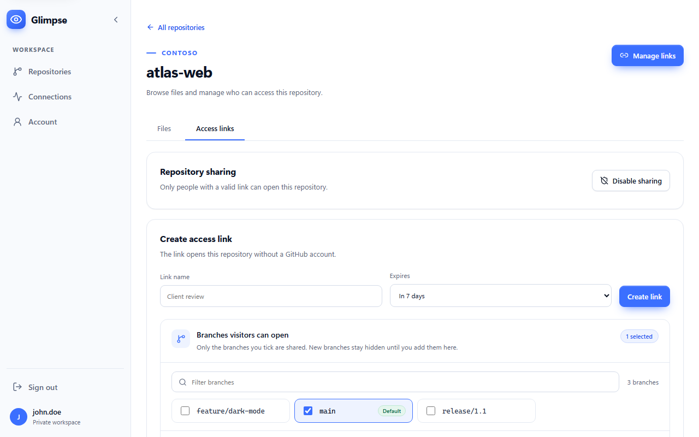
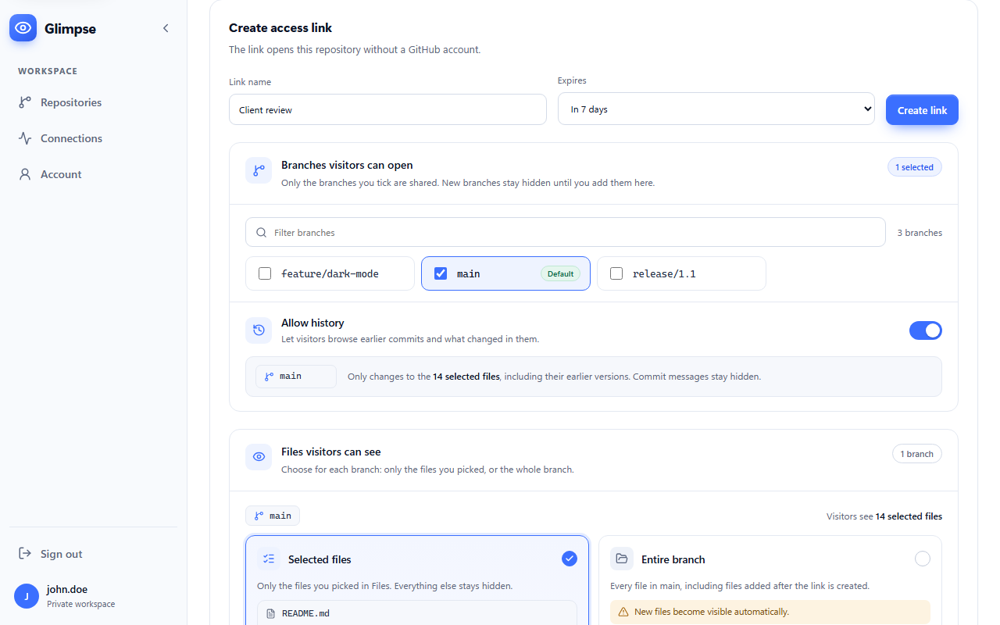
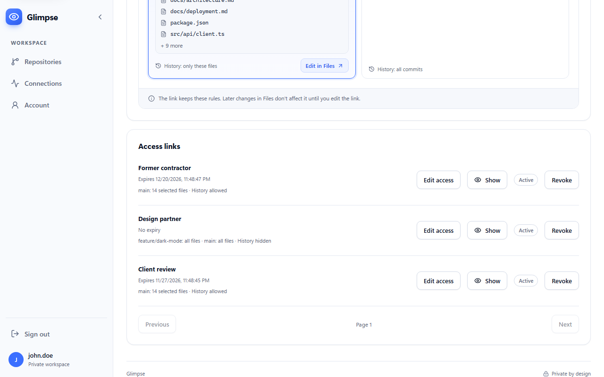
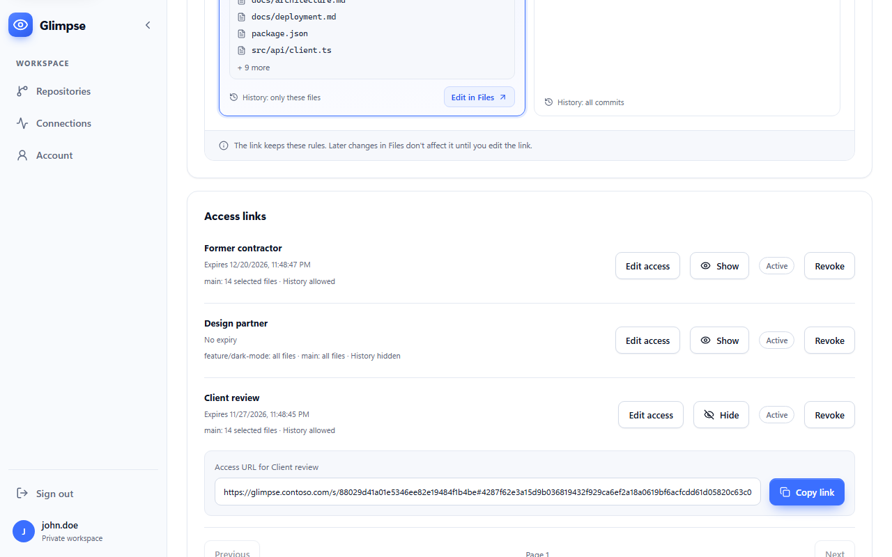
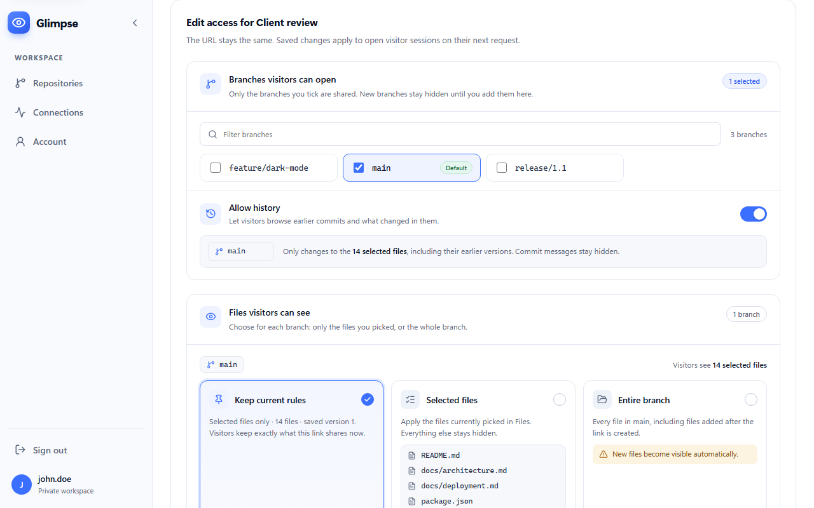
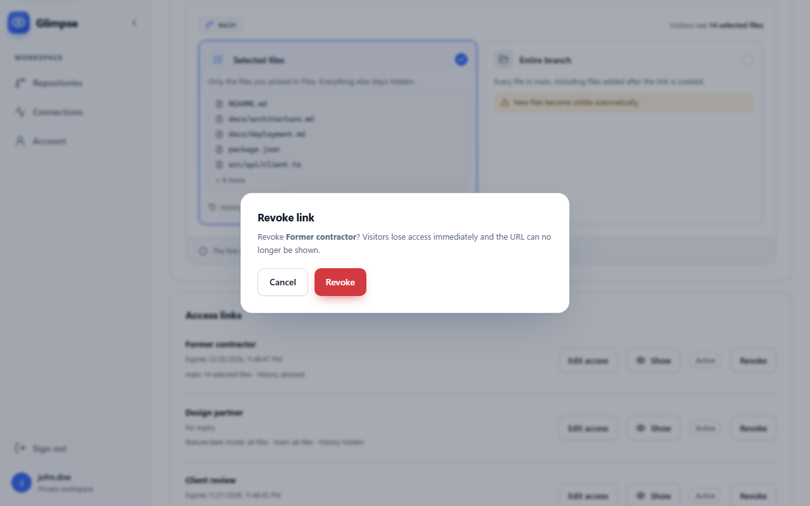
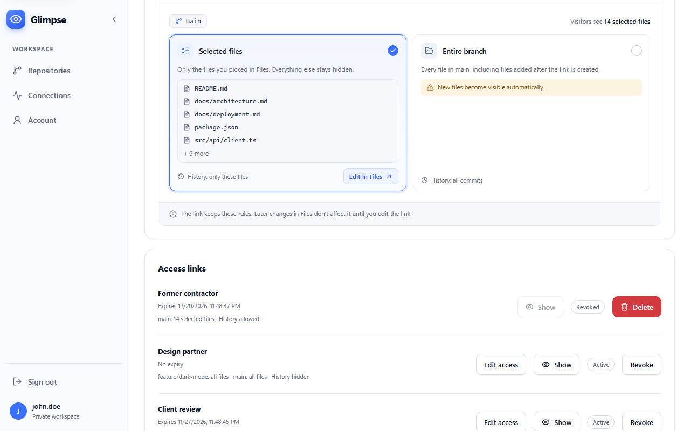

# 7. Access links

An access link opens one repository for anyone who has the link, read-only and without a GitHub, GitLab or Glimpse
account. Each link has its own branches, files, history access and expiry, and you can revoke it at any time.

Open a repository and choose the **Access links** tab, or click **Manage links**.

## Creating a link

Under **Create access link**:

1. Give the link a name that tells you who it is for, such as "Client review". Visitors do not see it.
2. Choose when it expires: **In 1 day**, **In 7 days**, **In 30 days** or **No expiry**.
3. Under **Branches visitors can open**, tick the branches to share. The default branch is ticked already, and
   **Filter branches** helps when there are many. A link can open up to 50 branches. Branches you do not tick, including
   branches created later, stay hidden.
4. Turn on **Allow history** if visitors may browse earlier commits and what changed in them. Without it, they see
   only the current files of the shared branches.
5. Under **Files visitors can see**, choose for each branch what the link shows.

For each branch there are two choices:

- **Selected files** shares the files you ticked in File visibility (chapter 6). The card lists the first few of them.
  **Edit in Files** opens File visibility for that branch if you want to change the selection first. When nothing is
  selected for the branch yet, the card is unavailable and **Choose files** takes you there.
- **Entire branch** shares every file of the branch, including files added after the link is created.

With history allowed, a branch with selected files shows only the commits that changed those files, together with their
earlier versions, and hides the commit messages. A branch shared entirely shows every commit with its message. The
summary under **Allow history** says which applies to each branch.

The link keeps these rules. Later changes in File visibility do not affect it until you edit the link.

Click **Create link** when every branch has a choice.

## Copying the link

The new link appears at the top of the tab:

Click **Copy link** and send it to the person you share with, for example by email or chat. Anyone who has it can
open the repository, so share it only with the people it is meant for. **Dismiss link** hides the box; you can show the
link again later.

The part of the link after `#` is its secret. Browsers never send that part to a server, so it does not appear in server
logs.

## The list of links

**Access links** lists every link of the repository, newest first. Each row shows the link's name, its expiry, a summary
of what it shares and its status: **active**, **expired**, **revoked**, or **disabled** when sharing is turned off for
the repository.

**Show** displays the link's address again, with **Copy link** to copy it. **Hide** puts it away.

## Changing what a link shares

**Edit access** changes the branches, history and files of a link. Its address stays the same, and visitors who have it
open see the change on their next click.

For each branch, **Keep current rules** leaves the files exactly as the link shares them now. **Selected files**
applies the files currently ticked in File visibility, and **Entire branch** shares the whole branch. Click **Save
access** to apply the changes.

A link's name and expiry cannot be changed. To give someone more time, create a new link and revoke the old one.

## Revoking and deleting

**Revoke** ends a link immediately. Visitors who open it see that the repository is unavailable, and its address can no
longer be shown.

A revoked link stays in the list, marked **revoked**, so you can see what was shared. **Delete** removes it from the list
for good.

## Turning sharing off for a repository

**Repository sharing** at the top of the tab turns all links of the repository off and on at once. **Disable sharing**
stops every link immediately without revoking it; the links show as **disabled**. **Enable sharing** makes them work
again, as long as they have not expired.

Links also stop working while the GitHub or GitLab connection they use is disconnected, and start working again when
you reconnect.
