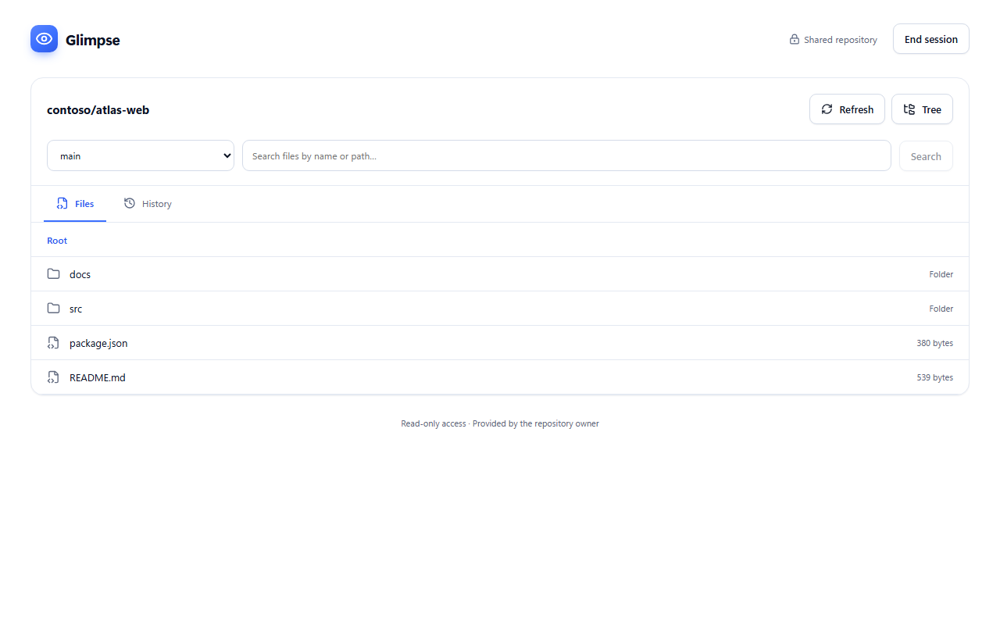
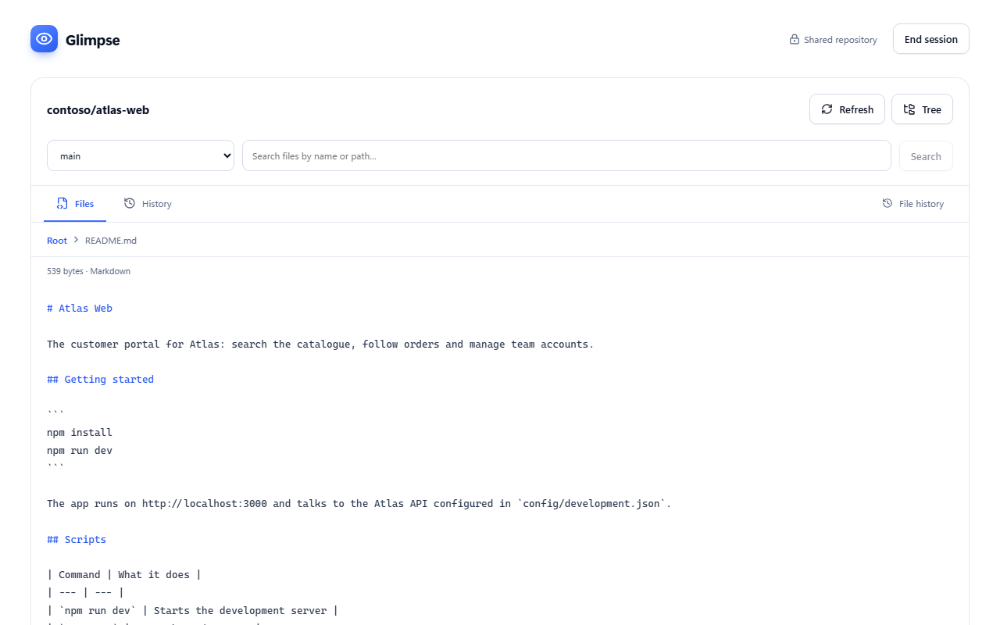
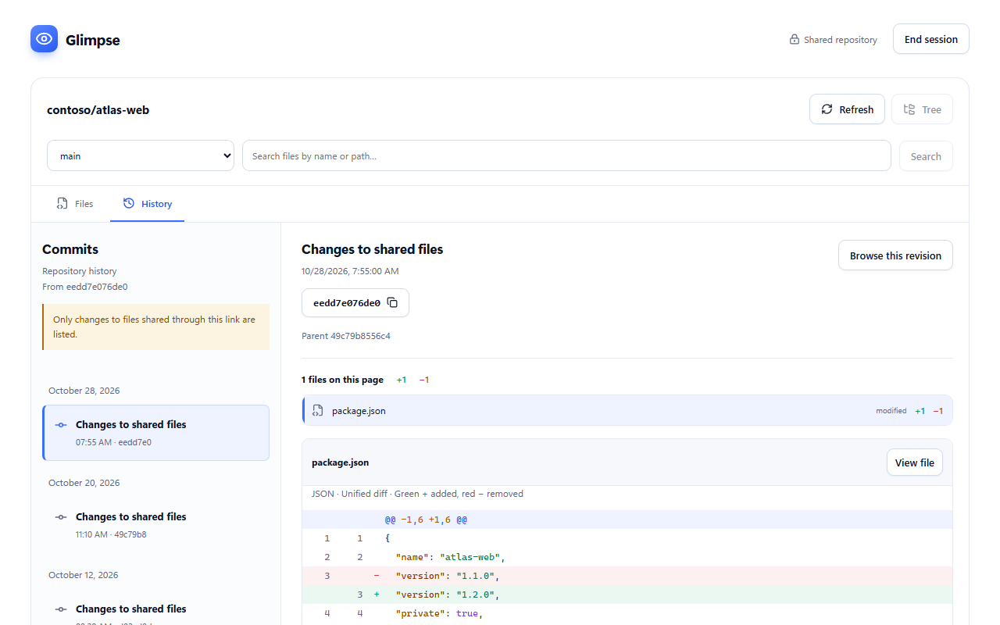
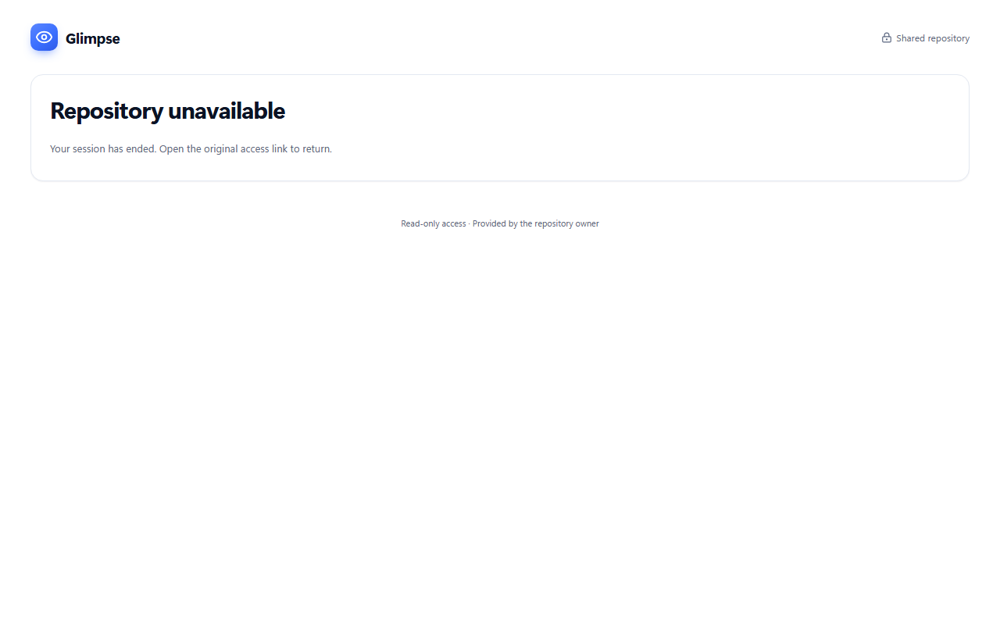
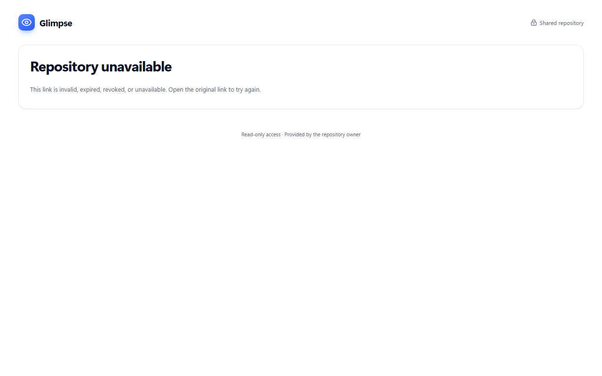

# 8. The visitor view

This chapter describes what people see when they open an access link you sent them. Visitors need no account and do
not sign in; the link alone gives access, read-only, to what the link allows.

## Opening a link

Opening the link starts a visitor session in the browser. Glimpse removes the secret part of the link from the address
bar right away, so it does not stay in the browser history. The session lasts 24 hours; within that time the visitor
can come back to the repository in the same browser without the full link.

The page shows the repository's name and the same browser as in the workspace (chapter 4), without a sidebar or
account. Visitors can:

- open folders and files, with syntax highlighting;
- use **Tree**, **Search files** and **Refresh**;
- switch between the branches the link shares;
- open **History** and **File history** if the link allows history.

They never see the **File visibility** button, branches the link does not share, or hidden files. Hidden files and
folders do not appear in the file list, the tree or search results at all, and opening one by its address shows that it
is not available.

## History for visitors

When the link allows history and the branch shares the entire branch, visitors see every commit with its message, just
as you do.

When the branch shares selected files, history shows only the commits that changed those files, and only the changes
to them. Commit messages stay hidden; each commit is titled "Changes to shared files". A note above the list says
"Only changes to files shared through this link are listed." Because Glimpse has to look through the history to find
these commits, older parts are loaded with **Older** or **Continue**.

## Ending the session

**End session** at the top right ends the visitor session in that browser. To return, the visitor opens the original
link again.

## When a link no longer works

A link stops working when it expires or is revoked, when sharing is turned off for the repository, when the owner's
GitHub or GitLab connection is removed, or when the owner's account is deactivated. The visitor then sees
"Repository unavailable" with a short explanation. For privacy, the page never says which of these happened.

If you changed what a link shares while a visitor had it open, their next click reflects the new rules. A file or
branch that is no longer shared shows a message asking them to reload.
