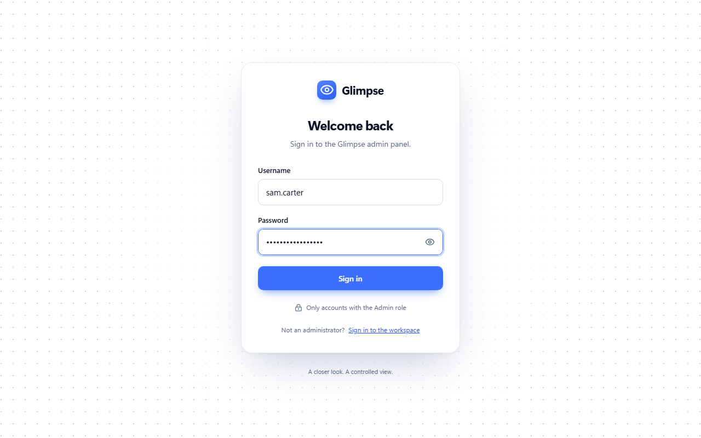
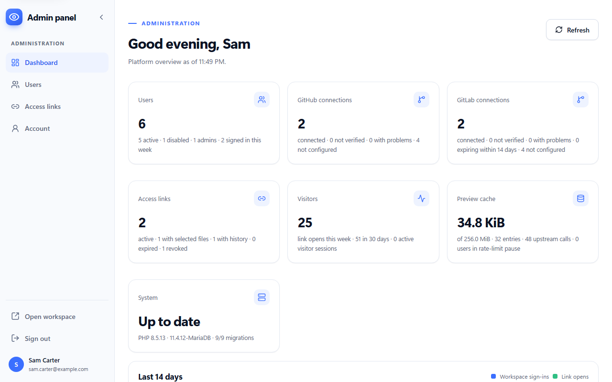
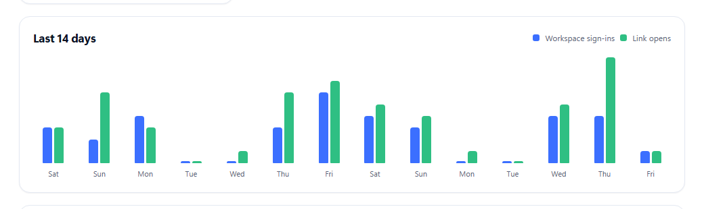
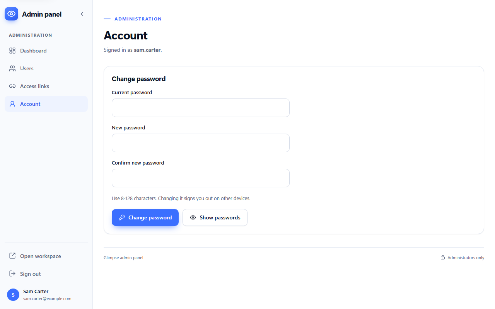

# 9. The admin panel

Administrators manage the accounts of an installation and can see and revoke every access link. The admin panel is a
separate part of Glimpse at `/admin`, open only to accounts with the Admin role.

## Signing in

Open `/admin` on your Glimpse address and sign in with your username and password. The admin session is separate from
the workspace session: signing in to one does not sign you in to the other.

Accounts without the Admin role cannot sign in here; they get the same "Invalid username or password." as for a wrong
password. **Sign in to the workspace** under the form leads to the normal sign-in page.

An admin session lasts eight hours.

## The sidebar

The admin sidebar holds **Dashboard**, **Users**, **Access links** and **Account**. At the bottom, **Open workspace**
switches to your own workspace and **Sign out** ends the admin session.

## The dashboard

The dashboard gives an overview of the installation. **Refresh** loads the latest numbers.

- **Users**: all accounts, with how many are active, deactivated, administrators and signed in this week.
- **GitHub connections** and **GitLab connections**: how many accounts are connected, not verified yet, have a problem
  or have no token. For GitLab, also how many tokens expire within 14 days.
- **Access links**: active links, and how many share selected files, allow history, have expired or were revoked.
- **Visitors**: how often links were opened this week and in the last 30 days, and how many visitor sessions are open.
- **Preview cache**: how much of the shared cache is in use, and how many users are paused because GitHub or GitLab
  limited their requests.
- **System**: whether the database is up to date, with the PHP and database versions and how many migrations are
  applied. "N pending" means an upgrade still needs `php bin/migrate.php`.

Below the cards, **Last 14 days** charts workspace sign-ins and link opens per day. Pointing at a day also shows how many
links were created.

**Configuration**, at the bottom, lists the installation's settings: the addresses the workspace answers on, the address
used in new access links, whether link addresses can be stored and shown, the key that encrypts tokens, the latest
database migration and the environment.

## Your admin account

**Account** in the admin sidebar changes your password, the same way as in the workspace (chapter 1).

If another administrator required a new password for you, the admin panel opens this page first.
