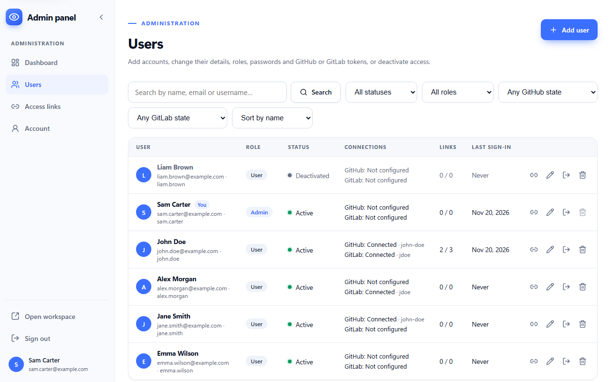
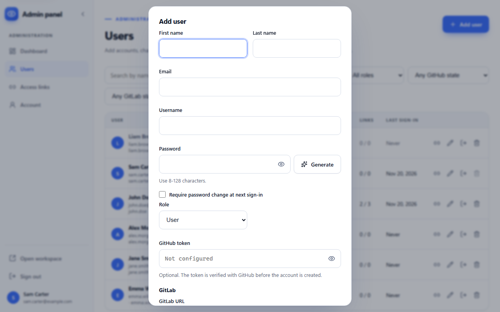
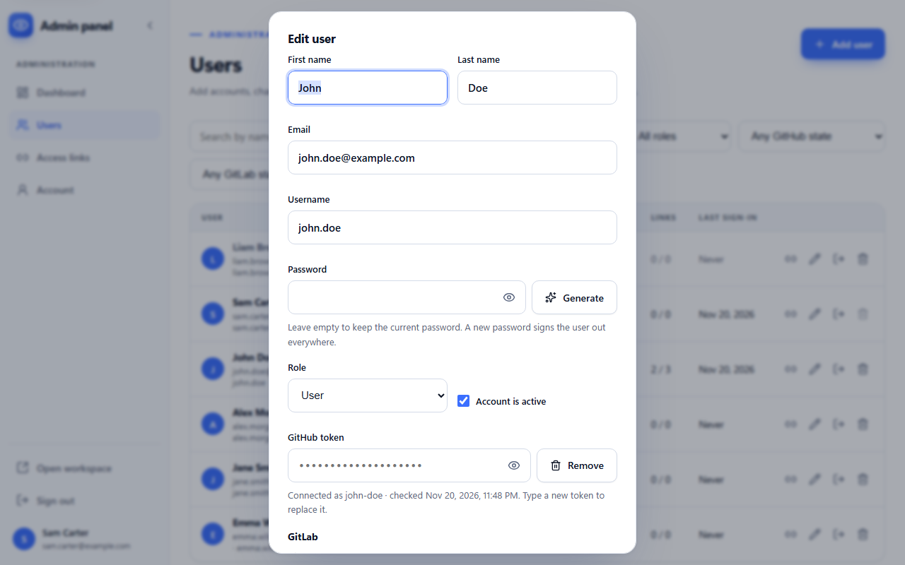
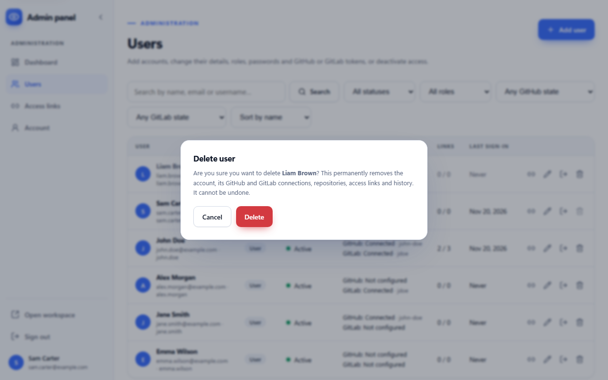
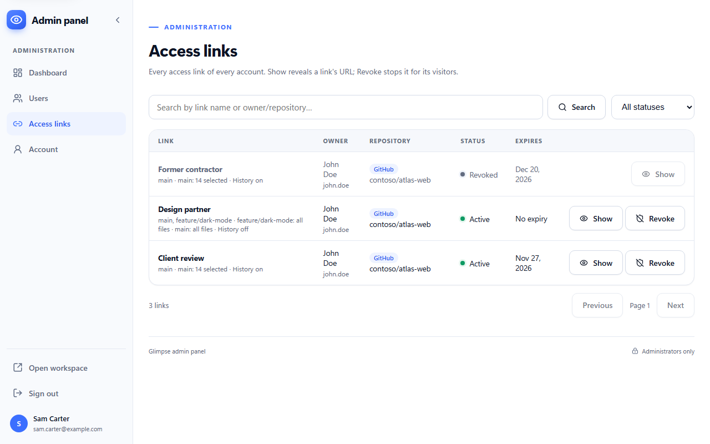
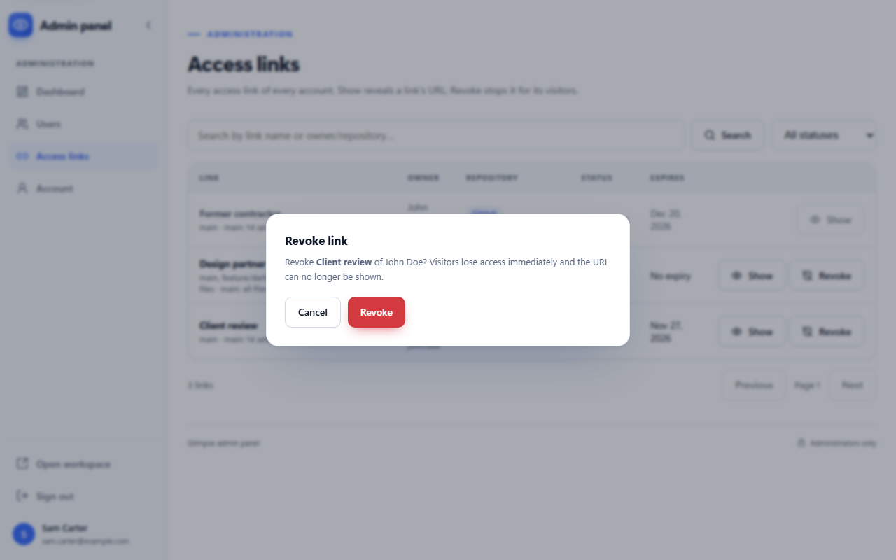

# 10. Users and links in the admin panel

This chapter covers the two lists of the admin panel: **Users**, where administrators manage accounts, and **Access
links**, which shows every link of every account.

## The user list

**Users** lists every account with its role, status, GitHub and GitLab connections, links and last sign-in.

The filters above the list narrow it down:

- **Search users** finds accounts by name, email or username.
- **Status**: active or deactivated accounts.
- **Role**: administrators or users.
- **GitHub** and **GitLab**: accounts with a given connection state, for example those whose token was rejected.
- **Sort**: by name, username, newest first or last sign-in.

**Links** shows each account's active links and all its links, for example "2 / 3". Deactivated accounts are dimmed.
The list holds 50 accounts per page.

The buttons at the end of each row:

- **Access links of this user** opens the link list filtered to that account.
- **Edit** opens the account.
- **Sign out everywhere** ends every workspace and admin session of the account. Its access links keep working.
- **Delete** removes the account. You cannot delete your own account.

## Adding a user

Click **Add user** and fill in the account:

- **First name** and **Last name** are required. **Email** is optional.
- **Username** has 3 to 32 characters: letters, digits, "_", "-" or ".". The user signs in with it.
- **Password** has 8 to 128 characters. **Generate** creates a random 20-character password and shows it, so you can
  pass it on. Tick **Require password change at next sign-in** to have the user choose their own password on first
  sign-in.
- **Role**: **User** for members, **Admin** for administrators. Administrators also have a normal workspace.
- **GitHub token**, and **GitLab URL** with **GitLab token**, are optional. When you enter them, Glimpse verifies them
  with GitHub or GitLab before creating the account, so the user's repositories are ready on first sign-in.

Click **Create** to add the account.

## Editing a user

**Edit** opens the same form with the account's details.

- Leave **Password** empty to keep the current password. A new password signs the user out everywhere.
- Untick **Account is active** to deactivate the account. The user can no longer sign in, and their access links stop
  working until the account is active again.
- The eye button next to a saved token shows it. Type a new token to replace it; Glimpse verifies it when you save.
  **Remove** deletes the token after asking; the user's links for that platform stop working until a token is saved
  again.

The bottom of the form shows when the account was created and last signed in, and how many repositories, active links
and link opens in the last 30 days it has. Click **Save** to apply the changes.

You cannot deactivate yourself, delete yourself or take away your own Admin role, and at least one active administrator
always remains.

## Deleting a user

**Delete** asks for confirmation first:

Deleting removes the account together with its GitHub and GitLab connections, repositories, access links and history.
It cannot be undone. To stop someone's access but keep their links for later, deactivate the account instead.

## All access links

**Access links** lists every link of every account, with its owner, repository, status and expiry.

Search by link name or repository, and filter by **Status**: active, expired or revoked. Opened from a user's row, the
list shows only that user's links; the X on the "Links of" chip shows all links again.

For an active link:

- **Show** displays the link's address with **Copy**, for example to help a user who lost it.
- **Revoke** ends the link immediately, after asking.

"Sharing disabled" under a repository means its owner turned sharing off (chapter 7). Administrators cannot delete links;
only their owners can.
